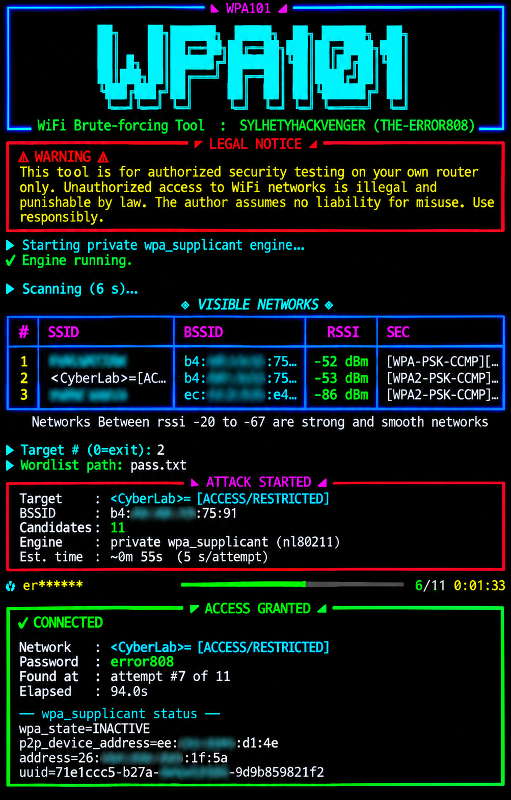

# WPA101 — WiFi Brute-forcing Tool
<p align="center">
  
</p>


<p align="center">
  
  
  
  
  
</p>

<p align="center">
  <b>◤ WPA101 ◢</b><br>
  <i>WiFi Brute-forcing Tool · SYLHETYHACKVENGER (THE-ERROR808)</i>
</p>

---

⚠️ LEGAL WARNING — READ FIRST

This tool is intended for authorized security testing on your own router or networks you have explicit written permission to test. Unauthorized access to WiFi networks is a criminal offense in most jurisdictions and is punishable by law. The author (SYLHETYHACKVENGER / THE-ERROR808) assumes no liability for misuse, damage, or legal consequences. By using this tool, you accept full responsibility for your actions. Use responsibly and ethically.

---

📖 Table of Contents

1. Overview
2. Key Features
3. Architecture
4. Requirements
5. Installation
6. Usage
7. How It Works
8. Screenshots
9. Troubleshooting
10. FAQ
11. Disclaimer
12. Author

---

🧠 Overview

WPA101 is a professional, OneShot-architecture WiFi brute-forcing engine built for rooted Android devices running Termux and Linux systems. It leverages a private wpa_supplicant instance communicating directly through the nl80211 driver — completely bypassing Android's HAL and framework restrictions.

Unlike traditional brute-forcers that rely on wpa_cli, wpa_supplicant.conf edits, or deprecated tools like reaver/bully, WPA101 spawns its own isolated wpa_supplicant process, talks to it via a UNIX control socket, and performs handshake-based PSK validation in real time.

The result is a fast, reliable, self-contained WPA2-PSK brute-forcing tool with a beautiful Rich-powered terminal UI.

---

✨ Key Features

Feature Description
🔒 Private wpa_supplicant Spawns an isolated instance — no conflict with system WiFi
📡 Direct nl80211 access Bypasses Android HAL, works on rooted devices
🎨 Rich terminal UI Neon-colored banners, tables, progress bars
⚡ Fast PSK validation Detects WRONG_KEY and 4-Way Handshake failed in real time
🔄 Auto rescan loop Press Enter to rescan without restarting the tool
📶 RSSI filtering Only shows networks in the -88 to -20 dBm range
🧠 Smart deduplication Keeps strongest BSSID per SSID
🛡️ Graceful cleanup Kills process, removes temp files, cleans socket
📊 Live progress bar Attempt counter, elapsed time, masked password
✅ Proof of connection Reads actual wpa_state=COMPLETED from supplicant
🚪 Clean exit 0 or q to quit, Ctrl+C for interrupt

---

<p align="center">
  
</p>

<h1 align="center">WPA101</h1>

<p align="center">
  <b>WiFi Security Testing • Gray Hat Cybersecurity</b>
  <br />
  SYLHETYHACKVENGER (THE-ERROR808)
</p>
---

📋 Requirements

Hardware

· Rooted Android device (Magisk / SuperSU / KernelSU)
· WiFi chipset supporting nl80211 (most modern phones)
· Linux PC with a compatible wireless adapter

Software

· Python 3.8+
· wpa_supplicant binary (with nl80211 driver support)
· root-repo + tsu (for Termux)
· rich Python library

Tested On

· Termux on Android 10–14 (rooted)
· Kali Linux (ARM64 / x86_64)
· Ubuntu 22.04 / 24.04

---
<p align="center">
  
</p>
🚀 Installation

Termux (Rooted Android)

```bash
pkg update && pkg upgrade -y
pkg install root-repo -y
pkg install tsu wpa_supplicant python git -y
pip install rich
git clone https://github.com/sylhetyhackvenger/WPA101.git
cd WPA101
```

Linux (Debian/Ubuntu/Kali)

```bash
sudo apt update
sudo apt install -y python3 python3-pip wpasupplicant wireless-tools
pip3 install rich
git clone https://github.com/sylhetyhackvenger/WPA101.git
cd WPA101
```

---

🎮 Usage

1. Gain Root Access

Termux:

```bash
tsu
```

Linux:

```bash
sudo -i
```

2. Verify Wireless Interface

```bash
ip link show wlan0
```

If your interface is different, edit IFACE at the top of WPA101.py.

3. Enable WiFi

```bash
svc wifi enable      # Android
nmcli radio wifi on  # Linux
```

4. Run WPA101

```bash
python3 WPA101.py
```

5. Interactive Workflow

```
[1] Tool scans for nearby networks (6 seconds)
[2] Displays a table of SSIDs with BSSID, RSSI, and security
[3] Prompts: ▶ Target # (Enter=rescan, 0=exit)
[4] Enter the number of your target network
[5] Enter the path to your wordlist
[6] Tool begins brute-forcing with live progress
[7] On success: shows password + wpa_supplicant status
[8] On failure: shows checklist + returns to scan menu
```

---

⚙️ How It Works

Step 1 — Private wpa_supplicant Initialization

WPA101 creates a temporary directory and writes a minimal wpa.conf:

```
ctrl_interface=/tmp/wpajoin_XXXXX
ctrl_interface_group=0
update_config=0
ap_scan=1
```

It then launches:

```bash
wpa_supplicant -K -d -Dnl80211,wext,hostapd,wired -i wlan0 -c /tmp/wpajoin_XXXXX/wpa.conf
```

Step 2 — Control Socket Communication

WPA101 binds a UNIX datagram socket and sends wpa_cli-style verbs directly to the supplicant's control interface:

Verb Purpose
SCAN Trigger a WiFi scan
SCAN_RESULTS Retrieve scan results
ADD_NETWORK Create a new network entry
SET_NETWORK <id> ssid "..." Set SSID
SET_NETWORK <id> psk "..." Set PSK candidate
SET_NETWORK <id> key_mgmt WPA-PSK Set key management
ENABLE_NETWORK <id> Enable the entry
SELECT_NETWORK <id> Attempt connection
STATUS Poll current wpa_state
REMOVE_NETWORK <id> Clean up
TERMINATE Graceful shutdown

Step 3 — Handshake Validation

For each password candidate:

1. A temporary network is added with the candidate PSK
2. Supplicant attempts the 4-way handshake
3. WPA101 polls STATUS for wpa_state=COMPLETED (success)
4. WPA101 also monitors the raw wpa_supplicant log for:
   · WRONG_KEY
   · 4-Way Handshake failed
   · pre-shared key may be incorrect
5. On failure, the network entry is removed and the next candidate is tried

Step 4 — Success Detection

When wpa_state=COMPLETED is detected, WPA101:

· Records the working password
· Prints the full STATUS output as proof
· Waits 3 seconds, then returns to the scan menu

---

🖼️ Screenshots

Add your screenshots to the assets/ folder and link them here.

```
◤ WPA101 ◢
WiFi Brute-forcing Tool · SYLHETYHACKVENGER (THE-ERROR808)

◈ VISIBLE NETWORKS ◈
┏━━━┳━━━━━━━━━━━━━━┳━━━━━━━━━━━━━━━━━━━┳━━━━━━━━━┳━━━━━━━━━┓
┃ # ┃ SSID         ┃ BSSID             ┃    RSSI ┃ SEC     ┃
┡━━━╇━━━━━━━━━━━━━━╇━━━━━━━━━━━━━━━━━━━╇━━━━━━━━━╇━━━━━━━━━┩
│ 1 │ HomeWiFi     │ aa:bb:cc:dd:ee:01 │ -45 dBm │ WPA2    │
│ 2 │ Neighbor_5G  │ aa:bb:cc:dd:ee:02 │ -62 dBm │ WPA2    │
│ 3 │ CafeGuest    │ aa:bb:cc:dd:ee:03 │ -78 dBm │ WPA2    │
└───┴──────────────┴───────────────────┴─────────┴─────────┘

Networks Between rssi -20 to -67 are strong and smooth networks

▶ Target # (Enter=rescan, 0=exit):
```

---

🛠️ Troubleshooting

❌ wpa_supplicant control socket never appeared

Cause: Your ROM strips nl80211 support from the binary.

Fix:

```bash
wpa_supplicant -Dnl80211 -i wlan0 -c /dev/null
```

If this fails, install a full wpa_supplicant build:

```bash
pkg install wpa_supplicant
```

❌ Permission denied on socket bind

Cause: Not running as root.

Fix:

```bash
tsu      # Termux
sudo -i  # Linux
```

❌ wlan0 not found

Cause: Interface name differs.

Fix: Run ip link and edit IFACE in WPA101.py.

❌ Scan returns no networks

Cause: WiFi disabled or driver busy.

Fix:

```bash
svc wifi enable
ip link set wlan0 up
```

❌ rich import error

Fix:

```bash
pip install --upgrade rich
```

❌ WPA3-only router

WPA101 targets WPA2-PSK. WPA3-SAE is not supported by this tool.

---

❓ FAQ

Q: Is this legal?
A: Only on networks you own or have written permission to test. Anything else is illegal.

Q: Does it work on non-rooted devices?
A: No. Root is required to spawn a private wpa_supplicant.

Q: Does it work on WPA3?
A: No. This tool targets WPA2-PSK only.

Q: Can it crack WPA2 handshakes offline?
A: No. WPA101 performs online PSK validation against a live AP.

Q: How fast is it?
A: ~5 seconds per candidate (AP-dependent). Adjust wait in join() for slower APs.

Q: Does it support multiple wordlists?
A: Not yet. Concatenate them first with cat list1 list2 > combined.txt.

Q: Can it save results?
A: Yes — pipe output: python3 WPA101.py | tee results.log

---

🔐 Disclaimer

WPA101 is provided as-is for educational and authorized security testing purposes only.

· The author is not responsible for any illegal use.
· The author is not responsible for any damage caused by misuse.
· Users must comply with all local, state, national, and international laws.
· Unauthorized WiFi access is a crime in virtually every country.

By downloading, installing, or running this tool, you acknowledge that you have read, understood, and agreed to this disclaimer.

---

👤 Author

SYLHETYHACKVENGER (THE-ERROR808)

· 🐙 GitHub: @sylhetyhackvenger
· 🎯 Focus: Offensive Security · WiFi Pentesting · Android Root Tooling
· 💬 Motto: "Break it to understand it. Understand it to protect it."

---

⭐ Support

If WPA101 helped you in a pentest, CTF, or research, please:

· ⭐ Star the repository
· 🐛 Report bugs via Issues
· 🔧 Submit PRs for improvements
· 📢 Share with the security community

---

📜 License

This project is licensed under the MIT License — see the LICENSE file for details.

---

<p align="center">
  <b>◤ WPA101 ◢</b><br>
  <i>Built with 🔥 by SYLHETYHACKVENGER · Use Responsibly</i>
</p>
```
